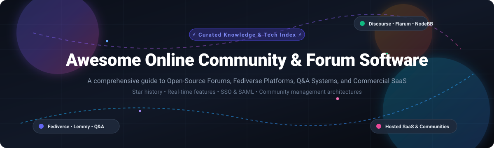

# 🌐 Awesome Online Community & Forum Software 🚀

> 📚 A definitive, curated catalog of the world's best **Online Community and Forum Software** platforms — encompassing high-scale open-source discussion forums, federated social networks (ActivityPub / Fediverse), developer Q&A engines, and modern SaaS community ecosystems.

  
  
  
  
  
  

🌟 **Star this repository if you find it helpful!** 🌟

---

## 🔍 SEO & Discoverability Overview

| Target Domain | Primary Keywords & Technologies |
|---|---|
| **Core Concepts** | Online Community Software, Discussion Forum Platforms, Open Source Forums, Self-Hosted Community Software, Message Board Systems |
| **Architectures** | ActivityPub Fediverse, WebSockets Real-time Forums, Headless Community CMS, Docker Self-Hosted Forums, Jamstack Q&A |
| **Leading Stacks** | Ruby on Rails (Discourse), Node.js (NodeBB), PHP & Laravel (Flarum), Go & React (Apache Answer), Rust (Lemmy), Python & Django (Misago) |
| **Enterprise Features** | SAML/SSO Authentication, SOC 2 Type II, GDPR Compliance, Federated Search, Monetization & Paid Memberships |

---

## 📋 Table of Contents 📑

- [📈 Sector Overview & Market Dynamics](#-sector-overview--market-dynamics)
- [🟦 SaaS / Hosted Platforms](#-saas--hosted-platforms)
- [🟩 Open-Source Community & Forum Software](#-open-source-community--forum-software)
  - [Discourse](#1-discourse-)
  - [Forem](#2-forem-)
  - [Flarum](#3-flarum-)
  - [Apache Answer](#4-apache-answer-)
  - [NodeBB](#5-nodebb-)
  - [Lemmy](#6-lemmy-)
  - [HumHub](#7-humhub-)
  - [WriteFreely](#8-writefreely-)
  - [Misago](#9-misago-)
  - [phpBB](#10-phpbb-)
  - [Talkyard](#11-talkyard-)
  - [MyBB](#12-mybb-)
  - [Simple Machines Forum](#13-simple-machines-forum-)
- [📊 Feature Matrix & Comparison at a Glance](#-feature-matrix--comparison-at-a-glance)
- [🤝 Contributing Guidelines](#-contributing-guidelines)
- [💖 Support & Sponsorship](#-support--sponsorship)
- [📈 Star History](#-star-history)
- [📄 License](#-license)

---

## 📈 Sector Overview & Market Dynamics 📊

The global online community and forum platform market is currently estimated between **$800M and over $6B** (projected to surpass $10B+ by the early 2030s at a CAGR of 10%–15%), scaling substantially when enterprise customer engagement suites and internal collaboration networks are incorporated. 

The industry demonstrates a **bifurcated market structure**:
* **Moderately to Highly Fragmented in Mid-Market & Creator Niches**: Rapidly growing SaaS entrants (e.g., Circle, Mighty Networks, Bettermode) and modular open-source solutions (e.g., Discourse, Flarum, NodeBB) compete aggressively across community-led growth (CLG), education hubs, creator memberships, and independent developer forums.
* **Concentrated at the Top Enterprise Layer**: Large-scale digital customer care hubs and enterprise employee social networks face high vendor consolidation under major private equity firms and enterprise conglomerates (e.g., Khoros under Vista Equity Partners, Higher Logic backed by JMI Equity).

---

## 🟦 SaaS / Hosted Platforms ☁️

Commercial, cloud-hosted Online Community and Forum Software platforms. These managed proprietary platforms provide managed infrastructure, enterprise compliance, and turnkey monetization. Sorted in descending order by company scale (annual revenue / valuation).

| 🏢 Platform | 💰 Company Scale (Revenue / Valuation) | 🏷️ Pricing (Starting Tier) | 🎁 Free Tier / Trial Limits | 🚀 Key Features & Positioning |
|---|---|---|---|---|
| **Khoros Communities** | ~$280M+ ARR *(Vista Equity Partners-backed)* | Custom enterprise quote *(starts ~$160,000/yr; onboarding ~$10k–$75k+)* | ❌ No permanent free plan; No free trial available *(enterprise sales demo only)* | Enterprise customer community forums, ideation hubs, federated search, and omnichannel social care for Global 2000 brands. |
| **Higher Logic Vanilla** | ~$68M ARR *($55M growth funding from JMI Equity)* | Custom enterprise quote *(starts ~$24,000/yr or ~$599/mo for up to 1,000 users)* | ❌ No permanent free plan; No public free trial *(guided sales consultation only)* | Enterprise community bundle with multi-forum architecture, advanced SSO (SAML/OAuth), deep CRM/helpdesk integrations, and SLAs. |
| **Circle** | ~$68M ARR *($200M–$250M valuation)* | $89/month *(Professional plan, billed annually)* | ❌ No permanent free plan; 14-day free trial *(full access to core community tools; no credit card required)* | All-in-one creator and modern brand community with native courses, live video rooms, paywalls, and discussion spaces. |
| **Mighty Networks** | ~$8M–$38M ARR *($200M–$250M valuation)* | $79/month *(Launch Plan, billed annually; 2% fee)* | ❌ No permanent free plan; 14-day free trial *(access to Launch and Course features; no credit card required)* | Creator- and educator-focused community with built-in native courses, iOS/Android mobile apps, livestreams, and memberships. |
| **Bettermode** | ~$3.1M ARR *($7.5M venture funding)* | $149/month *(Starter plan, billed annually; up to 10k members)* | ❌ No permanent free plan; 14-day free trial *(access to Starter/Growth features; no credit card required)* | Highly customizable customer community platform with AI search, modular layout builder, and CRM integrations. |
| **Invision Community** | ~$1.8M ARR *(Bootstrapped / privately held)* | $89/month *(Creator plan, billed annually)* | ❌ No permanent free plan; 14-day free trial *(subdomain URL, outbound email disabled, no marketplace addons; no card needed)* | Feature-rich forum and community platform with courses, live topics, calendar events, and granular content moderation. |

---

## 🟩 Open-Source Community & Forum Software 🛠️

Self-hosted, community-driven Online Community and Forum Software tools. Sorted in **descending order by GitHub Stars_Count**. Each repository badge links directly to its live GitHub stargazers.

### 1. Discourse 💬

* **Repository:** [discourse/discourse](https://github.com/discourse/discourse)
* **Tech Stack:** 💎 Ruby on Rails / PostgreSQL / Redis / Ember.js | **License:** 📜 GPL-2.0
* **Overview:** Discourse is the undisputed gold standard of modern open-source discussion forums. Trusted by major tech leaders including Docker, Figma, Rust, and Mozilla, Discourse features dynamic infinite scrolling, real-time typing indicators, automated spam filtering (Akismet integration), comprehensive trust levels, single sign-on (SAML, OAuth2, OpenID Connect), and an extensive ecosystem of 200+ plugins.
* **Hosting Requirements:** Minimum 2 GB RAM (4 GB recommended), 2+ CPU cores, 10 GB+ SSD, and mandatory SMTP server.
* **Best For:** Mid-to-enterprise open-source communities, product support forums, and teams needing industrial-grade moderation.

---

### 2. Forem 🌐

* **Repository:** [forem/forem](https://github.com/forem/forem)
* **Tech Stack:** 💎 Ruby on Rails / PostgreSQL / Redis / Preact | **License:** 📜 AGPL-3.0
* **Overview:** Forem (For Empowering Community) is the open-source software that powers the massive **DEV Community (dev.to)**. Designed to host modern, decentralized publication and social discussion networks, Forem provides native article authoring, nested commenting threads, podcast directories, tag-based following feeds, and badge gamification out of the box.
* **Hosting Requirements:** Minimum 4 GB RAM, containerized deployment via Docker/Kubernetes.
* **Best For:** Content-driven developer communities, publication hubs, and social blogging networks.

---

### 3. Flarum ⚡

* **Repository:** [flarum/flarum](https://github.com/flarum/flarum)
* **Tech Stack:** 🐘 PHP / MySQL / Mithril.js | **License:** 📜 MIT
* **Overview:** Flarum is a lightweight, blazing-fast forum platform engineered for simplicity and modern aesthetics. Designed as the minimalist counterpoint to heavy forum architectures, Flarum offers a single-page app (SPA) experience with a two-pane layout, instant infinite scrolling, Markdown support, and an extensible extension architecture managed via Composer.
* **Hosting Requirements:** Lightweight! Runs comfortably on 512 MB to 1 GB RAM with standard shared or VPS PHP hosting.
* **Best For:** Small to medium communities, hobbyist forums, and startups wanting an ultra-clean UI without heavy server overhead.

---

### 4. Apache Answer 💡

* **Repository:** [apache/answer](https://github.com/apache/answer)
* **Tech Stack:** 🐹 Go / React / TypeScript / SQLite or MySQL | **License:** 📜 Apache-2.0
* **Overview:** An official Apache Software Foundation project, Apache Answer is an open-source Q&A community software platform built as a modern, self-hosted alternative to Stack Overflow. Features include upvoting/downvoting systems, reputation scoring, tags, badge rewards, multi-language localization, and simple single-binary or Docker deployment.
* **Hosting Requirements:** Ultra-lean; single Go executable requiring as little as 256 MB to 512 MB RAM.
* **Best For:** Internal engineering knowledge bases, technical help desks, and product developer support portals.

---

### 5. NodeBB 🚀

* **Repository:** [NodeBB/NodeBB](https://github.com/NodeBB/NodeBB)
* **Tech Stack:** 🟢 Node.js / Redis or MongoDB / WebSockets | **License:** 📜 GPL-3.0
* **Overview:** NodeBB leverages instant WebSockets to deliver a real-time forum experience where new replies, notifications, and presence badges appear instantaneously without requiring page reloads. Includes desktop and mobile responsive themes, built-in search, social logins, and over 100 community plugins.
* **Hosting Requirements:** 1 GB to 2 GB RAM with Node.js and a Redis or MongoDB database instance.
* **Best For:** Real-time communities, gaming groups, live event discussion, and teams already invested in the JavaScript/Node ecosystem.

---

### 6. Lemmy 🪐

* **Repository:** [LemmyNet/lemmy](https://github.com/LemmyNet/lemmy)
* **Tech Stack:** 🦀 Rust / PostgreSQL / Actix / Inferno | **License:** 📜 AGPL-3.0
* **Overview:** Lemmy is a link aggregator and forum platform built for the **Fediverse** using the open **ActivityPub** standard. Inspired by Reddit and Hacker News, Lemmy instances can federate with one another seamlessly—allowing users registered on one server to subscribe, post, and comment on communities across any other server in the network.
* **Hosting Requirements:** High performance due to Rust; 1 GB to 2 GB RAM handles moderate federated traffic.
* **Best For:** Decentralized community organizers, privacy advocates, and open-web link aggregator enthusiasts.

---

### 7. HumHub 👥

* **Repository:** [humhub/humhub](https://github.com/humhub/humhub)
* **Tech Stack:** 🐘 PHP (Yii 2) / MySQL / MariaDB | **License:** 📜 AGPL-3.0
* **Overview:** HumHub is a flexible open-source social network and collaborative intranet suite. It combines message boards, user profiles, status streams, file sharing, calendar integrations, and virtual "Spaces" for private or public group collaboration. Features a rich marketplace with hundreds of third-party modules.
* **Hosting Requirements:** 1 GB to 2 GB RAM with standard LAMP/LEMP stack.
* **Best For:** Corporate intranets, non-profit volunteer hubs, alumni networks, and organization-wide collaboration portals.

---

### 8. WriteFreely ✍️

* **Repository:** [writefreely/writefreely](https://github.com/writefreely/writefreely)
* **Tech Stack:** 🐹 Go / SQLite or MySQL | **License:** 📜 AGPL-3.0
* **Overview:** WriteFreely is a minimalist, distraction-free federated blogging and community publishing platform. Built on ActivityPub, readers from Mastodon or Lemmy can follow individual authors or community blogs directly from their preferred social accounts. Offers multi-blog support and clean Markdown typography.
* **Hosting Requirements:** Lightweight Go binary running in <256 MB RAM.
* **Best For:** Writing collectives, decentralized blog networks, and minimalist community publications.

---

### 9. Misago 🐍

* **Repository:** [rafalp/Misago](https://github.com/rafalp/Misago)
* **Tech Stack:** 🐍 Python / Django / React / PostgreSQL | **License:** 📜 GPL-2.0
* **Overview:** Misago is a modern, responsive Python/Django forum application featuring clean React-based user interfaces. Misago brings threads, categories, user profiles, rich text editing, moderation tooling, and full Docker deployment capabilities to Python-centric stacks.
* **Hosting Requirements:** 1 GB to 2 GB RAM with PostgreSQL and Python runtime.
* **Best For:** Developers looking for a Django-native forum framework that integrates easily with existing Python applications.

---

### 10. phpBB 🛡️

* **Repository:** [phpbb/phpbb](https://github.com/phpbb/phpbb)
* **Tech Stack:** 🐘 PHP / MySQL / MariaDB / PostgreSQL / SQLite | **License:** 📜 GPL-2.0
* **Overview:** The most battle-tested and widely deployed classic forum bulletin board in internet history. phpBB provides hierarchical category forums, fine-grained permission control, attachment handling, customizable templates, OAuth2 / LDAP authentication, and thousands of community extensions.
* **Hosting Requirements:** Compatible with virtually any shared web host (256 MB+ RAM).
* **Best For:** Traditional message boards, retro enthusiast clubs, and administrators requiring low hosting expense and total data autonomy.

---

### 11. Talkyard 🗣️

* **Repository:** [debiki/talkyard](https://github.com/debiki/talkyard)
* **Tech Stack:** ☕ Scala / React / PostgreSQL / Redis | **License:** 📜 AGPL-3.0
* **Overview:** Talkyard unifies discussion forums, Stack Overflow-style Q&A questions, Slack-like team chat, and website blog comments into a single cohesive platform. Provides nested discussion threads, spam defense, single sign-on, and simple Docker-based deployment.
* **Hosting Requirements:** Minimum 2 GB RAM (due to JVM runtime).
* **Best For:** Teams that want forums, blog comments, and community Q&A unified under a single open-source system.

---

### 12. MyBB 🗂️

* **Repository:** [mybb/mybb](https://github.com/mybb/mybb)
* **Tech Stack:** 🐘 PHP / MySQL | **License:** 📜 LGPL-3.0
* **Overview:** MyBB is a free, user-friendly open-source forum package. It features standard forum mechanics, threaded/flat viewing options, inline moderation, private messaging, reputation points, and an accessible plugin system designed for simple customization.
* **Hosting Requirements:** Shared PHP host with 256 MB+ RAM.
* **Best For:** Hobbyists and community builders seeking an intuitive, classic message board with an easy administrative learning curve.

---

### 13. Simple Machines Forum ⚙️

* **Repository:** [SimpleMachines/SMF](https://github.com/SimpleMachines/SMF)
* **Tech Stack:** 🐘 PHP / MySQL / PostgreSQL | **License:** 📜 BSD-3-Clause
* **Overview:** Simple Machines Forum (SMF) is a time-tested, professional-grade forum package designed to deliver high stability and performance with minimal resource footprints. Features robust package management for modifications, multi-database support, and permissive BSD licensing.
* **Hosting Requirements:** Minimal; runs reliably even on legacy low-spec servers.
* **Best For:** Organizations seeking a proven bulletin board under a business-friendly, permissive BSD license.

---

## 📊 Feature Matrix & Comparison at a Glance 🔍

| Platform | Type / License | Technology Stack | Real-Time Sync | SSO / SAML | Self-Hosted | Primary Target / Use Case |
|---|---|---|---|---|---|---|
| **Discourse** | 📜 GPL-2.0 | Ruby / PostgreSQL / Redis | Polling / MessageBus | ✅ SAML, OAuth, OIDC | ✅ Yes | Enterprise discussion forums & developer communities |
| **Forem** | 📜 AGPL-3.0 | Ruby / PostgreSQL / Preact | WebSockets | ✅ Social Logins | ✅ Yes | Content publishing, blogging & social developer networks |
| **Flarum** | 📜 MIT | PHP / MySQL / Mithril | Polling (WebSocket ext) | ✅ Social & OAuth | ✅ Yes | Minimalist, fast, modern discussions |
| **Apache Answer** | 📜 Apache-2.0 | Go / React / SQLite / MySQL | REST / Polling | ✅ OAuth plugins | ✅ Yes | Self-hosted Q&A knowledge bases |
| **NodeBB** | 📜 GPL-3.0 | Node.js / Redis / MongoDB | ✅ WebSockets native | ✅ Social Logins | ✅ Yes | Real-time discussions & gaming hubs |
| **Lemmy** | 📜 AGPL-3.0 | Rust / Actix / PostgreSQL | ✅ WebSockets | ✅ ActivityPub Fediverse | ✅ Yes | Federated, decentralized link aggregation & communities |
| **HumHub** | 📜 AGPL-3.0 | PHP (Yii 2) / MySQL | Polling / SSE | ✅ LDAP / SAML / OAuth | ✅ Yes | Enterprise social intranet & collaborative spaces |
| **WriteFreely** | 📜 AGPL-3.0 | Go / SQLite / MySQL | REST | ✅ ActivityPub Fediverse | ✅ Yes | Federated community blogging & author collectives |
| **Misago** | 📜 GPL-2.0 | Python / Django / React | REST / Polling | ✅ Social Auth | ✅ Yes | Python/Django developers needing an integrated forum |
| **phpBB** | 📜 GPL-2.0 | PHP / MySQL / MariaDB | ❌ Polling | ✅ OAuth / LDAP | ✅ Yes | Classic, battle-tested bulletin board system |
| **Talkyard** | 📜 AGPL-3.0 | Scala / React / PostgreSQL | ✅ WebSockets | ✅ SAML / OAuth | ✅ Yes | Unified Q&A, forum, and blog comments engine |
| **MyBB** | 📜 LGPL-3.0 | PHP / MySQL | ❌ Polling | ✅ Plugins | ✅ Yes | Lightweight classic message boards |
| **SMF** | 📜 BSD-3-Clause | PHP / MySQL | ❌ Polling | ✅ Plugins | ✅ Yes | Permissive-license classic forum software |
| **Circle** | 🔒 Proprietary | Cloud SaaS | ✅ Live Rooms | ✅ Custom SSO (Plus) | ❌ Cloud | Creator communities, courses & paid memberships |
| **Mighty Networks**| 🔒 Proprietary | Cloud SaaS | ✅ Live Chat | 🟡 Enterprise plans | ❌ Cloud | Creator communities with native mobile apps |
| **Bettermode** | 🔒 Proprietary | Cloud SaaS | 🟡 Webhooks | ✅ Enterprise SSO | ❌ Cloud | Customizable customer & brand community hubs |
| **Khoros** | 🔒 Proprietary | Cloud SaaS | 🟡 Enterprise Sync | ✅ Enterprise SAML | ❌ Cloud | Large-scale enterprise customer engagement & support |
| **Vanilla** | 🔒 Proprietary | Cloud SaaS | 🟡 Real-time alerts | ✅ Enterprise SSO | ❌ Cloud | Mid-to-enterprise customer success communities |
| **Invision** | 🔒 Proprietary | Cloud SaaS | ✅ Live Topics | ✅ Enterprise SSO | ❌ Cloud | Full-featured hosted discussion & community suite |

---

## 🤝 Contributing Guidelines 💡

Contributions are warmly welcomed! Help us keep this directory accurate, up-to-date, and comprehensive:

1. 🍴 **Fork the repository** on GitHub.
2. 🌿 **Create a new branch** (`git checkout -b feature/add-new-platform`).
3. 📝 **Add your recommended platform** ensuring it satisfies the criteria:
   - Actively maintained (commit or release within the last 12 months).
   - Clear stack, licensing, and positioning description.
   - Live GitHub repository URL with Stars_Badge for open-source entries.
4. 🚀 **Commit your changes** (`git commit -m "Add New-Platform-Name to open-source directory"`).
5. 📤 **Submit a Pull Request** with a brief summary of why it should be listed.

---

## 💖 Support & Sponsorship ☕

If this curated repository helped you discover the perfect forum software, saved your team evaluation time, or provided architectural insights, please consider showing your support:

* ⭐ **Star this repository** to improve visibility across the community!
* 🍴 **Fork and share** with friends, colleagues, and developer groups.
* ☕ **Buy a coffee or sponsor the project:** Support ongoing maintenance, research, and curation on the **[GitHub Sponsors Dashboard](https://github.com/sponsors/ishandutta2007)**!

Thank you for being part of the open community! 🙌

---

## 📈 Star History

---

## 📄 License ⚖️

This collection is made available under the [CC0 1.0 Universal (Public Domain Dedication)](https://creativecommons.org/publicdomain/zero/1.0/). You can copy, modify, and distribute the work, even for commercial purposes, all without asking permission. Individual software packages listed retain their respective project licenses.

---

  <b>Built with ❤️ for community builders, software architects, and open-source creators worldwide.</b>

